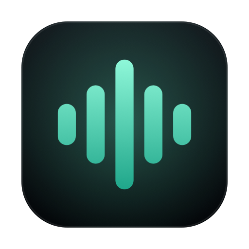

# PromptVoice

<p align="center">
  
</p>

<p align="center">
<strong>Dictado local para tus prompts.</strong><br>
Hablas, el texto se copia solo y aparece donde estás escribiendo.
</p>

<p align="center">
  
  
  
  
</p>

## El problema

Dictar prompts a un agente de código suele ser un ida y vuelta incómodo: abres el dictado del sistema, esperas, seleccionas, copias, vuelves a la terminal y pegas. Y si el dictado pasa por la nube, tu voz y tu texto salen del equipo.

**PromptVoice** quita todos esos pasos:

- Pulsas **⌥Espacio** (o el atajo que elijas), hablas y vuelves a pulsar el mismo atajo.
- El texto se transcribe **en tu Mac**, se copia al portapapeles y se pega directamente en la app que tenías delante.
- No cambias de ventana, no hay cuentas, no hay red.

Todo el reconocimiento se hace con el framework `Speech` de Apple en el dispositivo. El audio no se envía a ningún servidor.

## Cómo funciona para el usuario

```
⌥Espacio ──▶ micrófono ──▶ SpeechAnalyzer (en el Mac) ──▶ texto
                                                     ├──▶ portapapeles
                                                     └──▶ ⌘V en la app activa
```

1. Deja PromptVoice abierta (puede estar detrás o solo en la barra de menús).
2. Pon el foco en tu terminal o editor.
3. **⌥Espacio** para empezar, habla, **⌥Espacio** para parar.
4. Con *Pegar automáticamente* activo, el texto aparece escrito en tu agente. Pulsa Enter.

En la ventana principal:

- El borrador acumula dictados y se puede editar a mano.
- **⌘↩** graba/para cuando la ventana tiene el foco.
- Botones de copiar, limpiar e historial (clic en un reciente lo copia; clic derecho para borrarlo).
- Icono en la barra de menús con acceso rápido a grabar y copiar.
- Ajustes: idioma del dictado, atajo global, copiar al terminar y pegar automáticamente.

La primera vez que dictes, macOS descarga el modelo del idioma elegido y pide permiso de micrófono.

## Requisitos y compatibilidad

| | |
|---|---|
| **Sistema** | macOS 26 o superior |
| **Hardware** | Mac con Apple Silicon (probado en arm64; en Intel no está probado) |
| **Micrófono** | Obligatorio: USB, jack o Bluetooth. Los Mac mini no llevan micrófono integrado |
| **Para compilar** | Xcode 26 o superior (probado con Xcode 27) |
| **Dependencias** | Ninguna: solo SwiftUI, AVFoundation y Speech |

La app usa `SpeechAnalyzer` y `DictationTranscriber`, disponibles desde macOS/iOS 26. En versiones anteriores del sistema no existe este motor y la app no puede compilarse tal cual.

### Target iOS

El proyecto incluye un target iOS (`PromptVoiceiOS`) que comparte el mismo motor y la misma interfaz, para iPhone/iPad con **iOS 26 o superior**.

- Funciona en un dispositivo real.
- **No funciona en el simulador**: el runtime del simulador no soporta dictado *on-device* (`SpeechTranscriber.isAvailable` devuelve `false` y `AssetInventory` no ofrece formatos de audio). Por eso la vía para usar PromptVoice en el Mac es la app macOS.

## Instalación

```bash
git clone https://github.com/edward3s/promptvoice.git
cd voice
./scripts/run.sh            # compila y abre la app
./scripts/run.sh --install  # compila y la deja en /Applications/PromptVoice.app
```

También puedes abrir `PromptVoice.xcodeproj` en Xcode, seleccionar el scheme **PromptVoice** y pulsar Run.

La app se firma en local (*ad-hoc*), no necesita cuenta de desarrollador.

## Permisos

| Permiso | Para qué | ¿Obligatorio? |
|---|---|---|
| **Micrófono** | Grabar tu voz | Sí |
| **Accesibilidad** | Simular ⌘V en la app activa (*Pegar automáticamente*) | No |

Sin Accesibilidad el dictado sigue funcionando: el texto se copia al portapapeles y lo pegas tú.

Como la firma es *ad-hoc*, cada vez que recompiles la app macOS puede volver a pedirte el micrófono. Es normal en desarrollo; con la app ya instalada no vuelve a pasar.

## Privacidad

- El reconocimiento de voz se ejecuta **en el dispositivo** con los modelos del sistema. La app no hace peticiones de red.
- No hay analíticas, cuentas ni telemetría.
- El historial se guarda solo en tu Mac: `~/Library/Application Support/PromptVoice/history.json`.
- Lo único que sale de la app es el texto que tú copias o pegas.

## Cómo está programada

Sin dependencias externas. SwiftUI para la interfaz, `Observation` para el estado y `Speech` + `AVFoundation` para el audio.

```
PromptVoice/
├── SpeechEngine.swift    Motor: micrófono → SpeechAnalyzer → texto
├── DictationModel.swift  Estado de la app: borrador, copiado, pegado, historial
├── ContentView.swift     Interfaz (compartida macOS/iOS) y ajustes
├── Platform.swift        Diferencias iOS/macOS (portapapeles, permisos, feedback)
├── HotKey.swift          Atajo global: modelo y nombres de teclas
├── MacSupport.swift      Registro del atajo y ⌘V automático (solo macOS)
├── HistoryStore.swift    Historial persistente en JSON
└── PromptVoiceApp.swift        Punto de entrada, ventana y barra de menús
```

**Captura de audio.** `AVAudioEngine` instala un *tap* en el micrófono (bloques de 4096 frames). Un `AVAudioConverter` lo adapta al formato que pide el transcriptor (16 kHz, mono, Int16) y cada bloque se envía como `AnalyzerInput` a un `AsyncStream`.

**Transcripción.** `SpeechAnalyzer` consume ese stream con un `DictationTranscriber` configurado con el preset `progressiveLongDictation`. Los resultados llegan como `AsyncSequence`:

- los **volátiles** se muestran en vivo y se van reemplazando;
- los **finales** se acumulan en el texto definitivo;
- al parar, `finalizeAndFinishThroughEndOfInput()` fuerza el volcado de las últimas palabras antes de devolver el texto.

**Interfaz.** Un único `DictationModel` (`@Observable`) concentra estado y acciones, y lo comparten la ventana y la barra de menús. La misma vista sirve para macOS e iOS; las diferencias están aisladas en `Platform.swift` con `#if os(...)`.

**Atajo global.** `RegisterEventHotKey` de Carbon registra la combinación elegida (por defecto **⌥Espacio**) aunque la app no tenga el foco. En Ajustes hay un grabador: pulsas la combinación que quieras y se guarda para la próxima vez. Si otra app ya la usa, te avisa y puedes probar otra.

**Pegado automático.** La app no se activa al usar el atajo, así que el foco sigue en tu terminal. Tras copiar el texto, publica un evento ⌘V con `CGEvent`. Requiere permiso de Accesibilidad.

**Modelos de idioma.** `AssetInventory` comprueba si el modelo del idioma está instalado y lo descarga si hace falta; `SpeechTranscriber.supportedLocale(equivalentTo:)` resuelve variantes como `es_ES` → `es-ES`.

## Limitaciones conocidas

- Sin puntuación automática garantizada: el modelo inserta comas y puntos cuando el audio lo permite, pero no es perfecto. Puedes dictar “coma” o “punto” si necesitas precisión.
- La app no arranca sola al iniciar sesión (todavía).
- Al distribuir un binario compilado sin notarizar, macOS lo marcará como de desarrollador no identificado. La opción recomendada es compilar desde el código; si descargas un `.zip`, quita la cuarentena:

  ```bash
  xattr -dr com.apple.quarantine /Applications/PromptVoice.app
  ```

- Si el atajo elegido choca con otra app, el registro falla y la app te lo indica en Ajustes; elige otra combinación.

## Contribuir

Issues y pull requests son bienvenidos. Si vas a tocar el motor de audio, prueba con un micrófono real: el simulador de iOS no sirve para validar la transcripción.

Ideas que encajarían bien: arranque al iniciar sesión, parada automática por silencio, diccionario de términos técnicos (`AnalysisContext`), un historial con búsqueda y una release firmada y notarizada.

## Licencia

MIT. Ver [LICENSE](LICENSE).

---

### English summary

PromptVoice is a native macOS dictation app for writing prompts to coding agents. Press **⌥Space** (the shortcut is configurable), speak, press it again: the text is transcribed **on-device** with Apple's `SpeechAnalyzer`, copied to the clipboard and optionally pasted into the frontmost app. No cloud, no accounts, no dependencies. Requires macOS 26+ (Apple Silicon) and a microphone; build with Xcode 26+ (`./scripts/run.sh`). The iOS target requires iOS 26+ and a real device (the Simulator does not support on-device dictation). MIT licensed.
